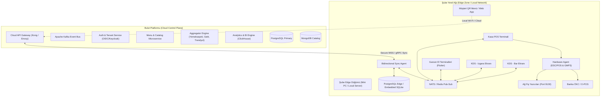
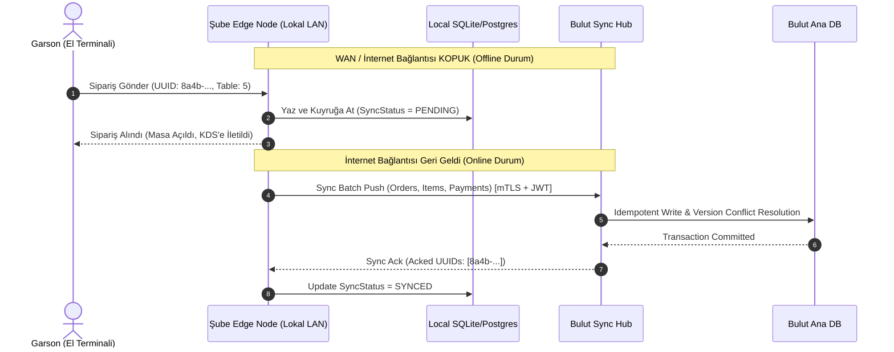
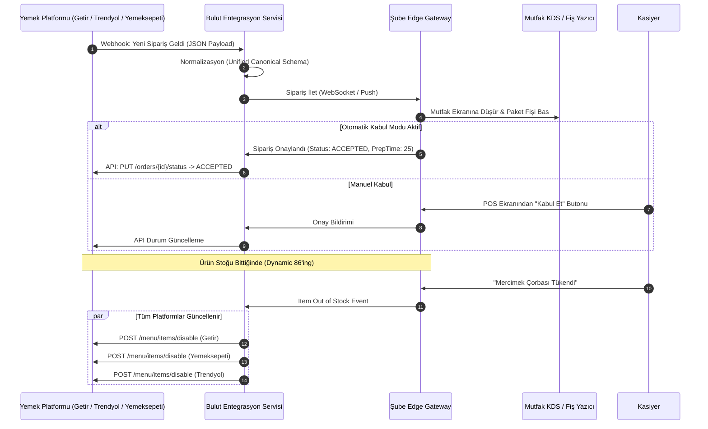
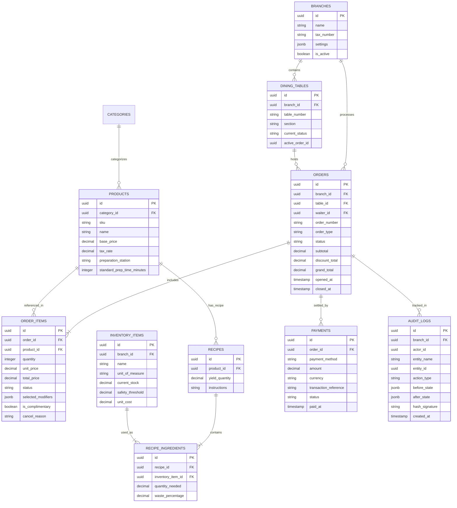
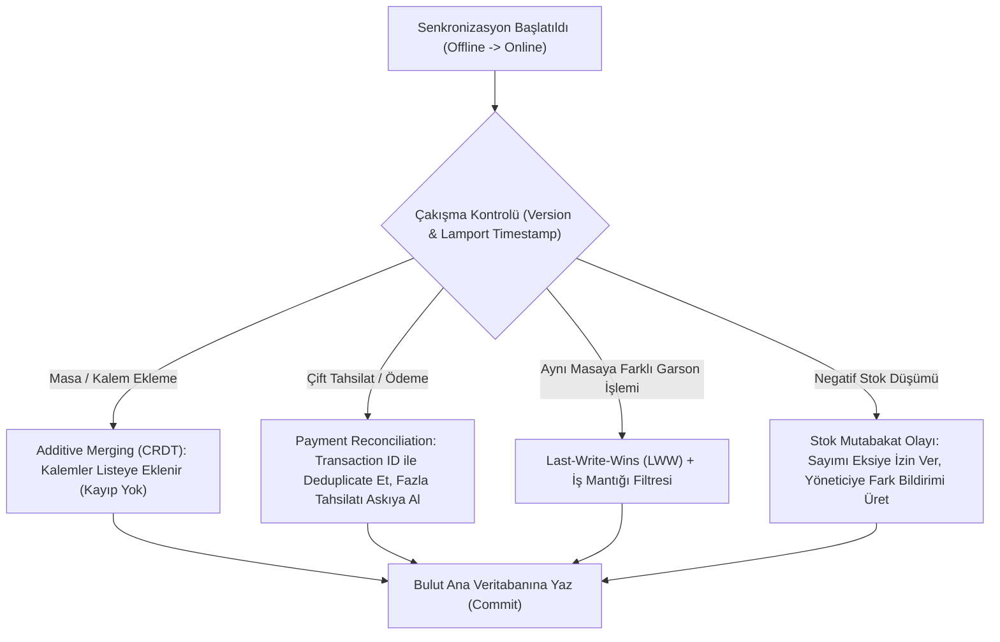

# UÇTAN UCA RESTORAN OTOMASYON SİSTEMİ (ENTERPRISE RMS)
## TEKNİK MİMARİ VE SİSTEM ŞARTNAMESİ DOKÜMANI

---

### DOKÜMAN BİLGİLERİ
- **Doküman Versiyonu:** 1.0.0-RELEASE
- **Hedef Sistem:** Enterprise Restoran Yönetim Sistemi (RMS - Restaurant Management System)
- **Mimari Tip:** Dağıtık, Hibrid Bulut / Offline-First Edge Event-Driven Mimari
- **Kapsam:** POS, KDS, Envanter, Dijital Menü, Mobil Sipariş, Paket Servis Entegrasyonları, Mali e-Dönüşüm ve Analitik

---

## 1. SİSTEM MİMARİSİ & DAĞITIK ALTYAPI

### 1.1. Genel Mimari Yaklaşım: Karşılaştırmalı Analiz ve Hibrit Edge-Cloud Modeli

Restoran operasyonları doğası gereği milisaniyelik gecikme (latency < 50ms) gerektiren, yüksek hacimli eşzamanlı istek alan ve internet kesintilerine sıfır toleransı olan fiziksel ortamlardır. Saf monolitik mimariler ölçeklenemezken; saf mikroservis mimarileri ise şube seviyesindeki internet kesintilerinde operasyonun felç olmasına sebep olur.

Bu şartnamede seçilen ve tavsiye edilen mimari: **Hibrit Edge-Cloud Event-Driven Mimari (Dağıtık Hibrit Model)**'dir.

#### Mimari Karşılaştırma Matrisi

| Kriter | Saf Monolitik | Saf Cloud Mikroservis | Hibrit Edge-Cloud (Önerilen) |
| :--- | :--- | :--- | :--- |
| **Offline Çalışabilirlik** | Çok Düşük (Sunucu giderse biter) | Sıfır (İnternet kesintisinde durur) | **%100 (Yerel Edge düğümünde kesintisiz)** |
| **Ölçeklenebilirlik** | Kısıtlı dikey ölçekleme | Mükemmel yatay ölçekleme | **Mükemmel (Bulut bağımsız, şube otonom)** |
| **Ağ Gecikmesi (Latency)** | Değişken (Ağ kalitesine bağlı) | 150ms - 500ms (Cloud roundtrip) | **< 15ms (Yerel LAN içi anlık iletişim)** |
| **Geliştirme & Dağıtım** | Kolay başlangıç, zor bakım | Yüksek operasyonel maliyet | **Modüler domain yapıları, izole donanım katmanı** |
| **Donanım Entegrasyonu** | Sürücü bağımlı | WebSockets/WebRTC köprüleri şart | **Yerel Edge Device Gateway ile native TCP/Raw** |



---

### 1.2. Katmanlı Mimari ve Bileşen Dağılımı

Sistem, fiziksel ve mantıksal olarak 4 ana katmandan meydana gelir:

1. **İstemci Katmanı (Client Layer):**
   - **Kasa POS (Desktop):** Electron veya Flutter Desktop tabanlı, yerel donanım çevre birimlerine (para çekmecesi, barkod okuyucu, çift ekran/müşteri ekranı) doğrudan erişebilen native arayüz.
   - **Garson Terminali (Mobile):** Android/iOS üzerinde çalışan, offline-ready SQLite cache barındıran Flutter mobil istemcisi.
   - **KDS (Mutfak Ekranı):** Düşük donanımlı Android TV veya endüstriyel dokunmatik panellerde çalışan, dokunmatik ve bump bar klavye (USB HID) destekli React/Flutter Web kiosk uygulaması.
   - **Müşteri QR (Self-Order):** Sıfır kurulum gerektiren mobil uyumlu Next.js PWA.

2. **Edge Katmanı (Şube İçi Yerel Sunucu / Edge Gateway):**
   - Şube içerisinde çalışan mini-PC (Intel NUC vb.) üzerinde K3s veya Docker Compose konteynerleri olarak koşar.
   - **Local Message Broker (NATS.io):** Şube içindeki POS, KDS ve el terminalleri arasında sıfır gecikmeli (sub-millisecond) mesajlaşma sağlar.
   - **Local Database (PostgreSQL Edge):** Şubenin o anki açık masalarını, güncel menüsünü ve aktif vardiya verilerini barındırır.
   - **Hardware Daemon (C#/Rust/Go tabanlı servis):** ESC/POS soket yönlendiricisi, seri port (RS232) dinleyicisi ve GMP3 mali cihaz sürücülerini barındırır.

3. **Bulut API & Event Streaming Katmanı:**
   - **API Gateway (Kong / Envoy):** Rate limiting, mTLS şube doğrulaması, JWT validation ve ters yük dengeleme.
   - **Message Broker (Apache Kafka):** Çoklu şube veri aktarımı, stok hareketi olayları, sipariş logları ve entegrasyon webhook kuyrukları için dağıtık log omurgası.
   - **Cache Katmanı (Redis Cluster):** Menü ağacı önbelleği, distributed lock (Redlock ile çift adisyon tahsilatını engelleme), anlık websocket oturum registry'si.

4. **Veri ve Raporlama Katmanı:**
   - Transactional Core: PostgreSQL 16 (Patroni ile High-Availability kümesi).
   - Analitik & Raporlama: ClickHouse (Gerçek zamanlı ciro, ürün satış trendleri, KDS bekleme analitikleri).

---

### 1.3. Veritabanı Topolojisi ve Veri Yönetimi

Sistemde **Polyglot Persistence** yaklaşımı benimsenmiştir:

- **İlişkisel Veritabanı (PostgreSQL 16 Enterprise):** Siparişler, adisyonlar, finansal ödemeler, cari hesaplar, reçeteler ve kullanıcı rolleri için kullanılır. ACID prensiplerine tam uyumludur. Şube bazlı mantıksal bölümleme (Table Partitioning: `PARTITION BY LIST (branch_id)`) uygulanır.
- **Döküman Deposu (MongoDB veya PG JSONB):** Sıkça değişen ürün varyasyonları, ek malzeme grupları (modifier groups), restoran konfigürasyon şablonları ve dinamik menü şemaları için kullanılır.
- **Dağıtık Önbellek (Redis 7.x):** 
  - Aktif masa oturum kilitleri (Distributed Locking).
  - Webhook de-duplication (idempotency key saklama).
  - Canlı sepet ve sipariş hazırlık kuyrukları.
- **Değişiklik Verisi Yakalama (CDC - Change Data Capture):**
  - PostgreSQL üzerindeki sipariş ve stok tablolarından **Debezium** aracılığıyla Kafka'ya olay fırlatılır. Böylece stok servisleri ve merkezi analitik sistemler transactional operasyonu yavaşlatmadan asenkron olarak beslenir.

---

### 1.4. Dağıtım, DevOps & Offline-First POS Stratejisi



#### Offline Çalışabilirlik Kuralları:
1. **İstemci Bağımsızlığı:** POS ve El terminalleri doğrudan buluta bağlanmaz; tüm istekler şube yerel ağındaki Edge IP adresine yapılır.
2. **Yerel Veri Depolama:** Şube Edge Node'unda son 30 günün menü, reçete, personel PIN ve açık masa verileri sürekli replike halde tutulur.
3. **Kuyruk Dayanıklılığı:** İnternet kesildiğinde tüm siparişler ve mali hareketler yerel diske yazılan kalıcı (persistent) kuyrukta (`outbox_events`) saklanır.
4. **Idempotent Senkronizasyon:** İnternet bağlandığında her kayıt istemcide üretilen `UUID v7` anahtarlarıyla buluta aktarılır; ağ tekrarlarında çift kayıt oluşmaz.

---

## 2. TEMEL MODÜLLER & FONKSİYONEL GEREKSİNİMLER

### 2.1. POS (Point of Sale) & Kasa Yönetimi

POS modülü operasyonun kalbidir ve aşağıdaki kritik kuralları içerir:

- **Masa & Salon Yönetimi:** Kat/salon bazlı vektörel krokiler, masa durumları: `BOŞ`, `AÇIK`, `SİPARİŞ_BEKLİYOR`, `HESAP_İSTENDİ`, `REZERVE`, `KİRLİ`.
- **Adisyon Bölme (Split Bill) Algoritmaları:**
  1. *Kalem Bazlı Bölme (Item-level split):* Masadaki belirli ürünlerin (ör. 2 kahve, 1 tatlı) yeni bir adisyona veya yan masaya aktarılması.
  2. *Eşit Tutar Bölme (Equal split):* Toplam tutarın n adet kişiye bölünerek her birinden ayrı ayrı nakit/kredi kartı tahsil edilmesi.
  3. *Özel Tutar Bölme (Custom amount payment):* Kalan bakiyeden istenen miktarın düşülmesi.
- **İskonto & İkram Kuralları:**
  - Yüzdesel (%) veya Sabit Tutar (TL) indirimi.
  - İkram durumunda ürün tutarı 0 TL yapılır ancak reçete stok düşümü devam eder (`is_complimentary = true`).
  - İptal işlemlerinde: Ürün hazırlanmadan önce mi, sonra mı iptal edildi bilgisi (`waste_recorded: boolean`) zorunludur.
- **Fiş Yazıcı Protokolleri (ESC/POS Entegrasyonu):**
  - Ağ yazıcıları için standart `Raw TCP Socket (Port 9100)` bağlantısı kullanılır.
  - Hata toleransı: Yazıcı kağıdı bittiğinde veya çevrimdışı olduğunda yazdırma görevi kuyrukta kalır ve Kasa POS ekranında görsel/sesli uyarı oluşturur.

```
[ESC/POS Örnek Binary Akışı]:
[1B 40]             --> Initialize Printer (ESC @)
[1B 61 01]          --> Align Center (ESC a 1)
[1D 21 11]          --> Double Width & Height Text (GS ! 17)
"RESTORAN ADI\n"
[1B 61 00]          --> Align Left (ESC a 0)
[1D 21 00]          --> Normal Text Size
"Masa: Salon-4        Tarih: 08.10.2026 18:30\n"
"------------------------------------------\n"
"1x Antrikot Izgara (Orta Pişmiş)    550.00 TL\n"
"   + Mantar Sos                      40.00 TL\n"
"1x Ayran                             35.00 TL\n"
"------------------------------------------\n"
[1B 61 02]          --> Align Right
"TOPLAM: 625.00 TL\n"
[1D 56 41 03]       --> Cut Paper (GS V A 3)
[10 14 01 00 05]    --> Pulse Drawer Open (DLE DC4)
```

---

### 2.2. KDS (Kitchen Display System - Mutfak Ekranı)

KDS, siparişlerin mutfakta hazırlanma süreçlerini koordine eder.

- **İstasyon Bazlı Yönlendirme:** Gelen bir adisyondaki ürünler mutfak rotalama motoru tarafından kategorilerine göre istasyon ekranlarına ayrıştırılır:
  - *Izgara İstasyonu:* Etler, ızgara çeşitleri.
  - *Fırın/Pide İstasyonu:* Pizza, lahmacun.
  - *Soğuk / Meze İstasyonu:* Salatalar, zeytinyağlılar.
  - *Bar İstasyonu:* Kokteyller, meşrubatlar, kahveler.
- **Cook Time Pacing (Hold & Fire / Akıllı Pişirme Geciktirmesi):**
  - Örneğin: Bir masada 25 dakika süren `Bonfile` ile 6 dakika süren `Mevsim Salata` aynı anda sipariş edildiyse; KDS salatayı ilk 19 dakika boyunca `HOLD` (Beklemede) statüsünde tutar. Geri sayım 6. dakikaya geldiğinde ekranda `FIRE` uyarısıyla aşçıya düşürür. Böylece tüm masa ürünleri aynı anda sıcak servis edilir.
- **Personel Etkileşimi:** Endüstriyel Bump Bar (Klavye tuş kodları: `ENTER` -> Tamamla/Bump, `F1` -> Geri Al/Recall, `F2` -> Beklet/Hold) ve Su geçirmez IP65 dokunmatik ekranlar.
- **SLA Renk & Sesli Uyarı Skalası:**
  - `0 - 8 dk:` Yeşil Çerçeve (Normal).
  - `8 - 14 dk:` Sarı Çerçeve + Tek Bip Sesi (Uyarı).
  - `> 15 dk:` Yanıp sönen Kırmızı Çerçeve + Çift Bip Alarmı (Gecikmiş / Kritik).

---

### 2.3. Dijital Menü & Masadan Müşteri Siparişi (Self-Order)

- **Dinamik & Güvenli QR Kod Altyapısı:** Masalardaki statik QR kodların kötüye kullanımını (fotoğrafının çekilip dışarıdan sipariş verilmesini) engellemek için **Dynamic Expiring Token** mimarisi uygulanır:
  $$\text{QR URL} = \texttt{https://restoran.com/m/\{table\_id\}?t=\{HMAC\_SHA256(table\_id + timestamp, secret)\}}$$
  Masa açıldığında token üretilir; masa kapandığında eski link geçersiz hale gelir.
- **Sipariş Modları (Şube Bazlı Yapılandırılabilir):**
  1. *Yalnızca İncele:* Menü ve alerjen inceleme, garson çağırma.
  2. *Onaylı Sipariş:* Masadan verilen sipariş önce garson el terminaline bildirim olarak düşer, garson "Onayla" dediğinde KDS'e iletilir.
  3. *Doğrudan Sipariş & Masada Ödeme:* Sanal POS (Kredi Kartı / Apple Pay) üzerinden tahsilat yapılır yapılmaz sipariş anında mutfak KDS'ine iletilir.
- **Masa Çağrı Mekanizması:** WebSockets üzerinden `GARSON_CAGIR`, `HESAP_ISTE (NAKİT)`, `HESAP_ISTE (KART)` sinyalleri el terminallerine titreşim ve ses bildirimi olarak dağıtılır.

---

### 2.4. Garson Terminali (El Terminali / Mobil POS)

- **Platform:** Cross-platform (Flutter tabanlı Android/iOS istemci). Endüstriyel el terminalleri (Sunmi V2, IMIN, Pax) ile dahili kamera barkod ve NFC desteği.
- **Hızlı Sipariş Girişi UX:**
  - Tek ekranda ürün, porsiyon, pişme derecesi ve ek malzeme (modifier) seçimi.
  - Alerjen uyarı filtreleri (Gluten, Laktoz, Fıstık vb.).
- **Canlı Durum Senkronizasyonu:**
  - WebSockets / SignalR ile masanın o an başka bir garson tarafından kilitlenip kilitlenmediği anlık gösterilir (`Optimistic UI + Conflict Check`).
  - Mutfaktan tamamlanan ürünlerde anında "Masa 4 - Sipariş Hazır" bildirimi düşer.

---

### 2.5. Stok & Reçete (BOM - Bill of Materials) Yönetimi

- **Dinamik Reçete Ağacı:**
  - Her nihai ürün, hammadde kalemlerine ve yarı mamullere (sub-recipes) gramaj/litre bazında bağlanır.
  - *Örnek Reçete Hiyerarşisi:*
    - 1 Porsiyon Cheeseburger = 
      - 1 Adet Burger Ekmeği
      - 1 Porsiyon Burger Köftesi (Yarı Mamul -> 160 gr Kıyma, 5 gr Tuz, 2 gr Baharat)
      - 2 Dilim Cheddar Peyniri (40 gr)
      - 20 gr Özel Sos (Yarı Mamul -> Mayonez, Turşu, Hardal)
      - %5 Standart Pişirme Firesi
- **Gerçek Zamanlı Düşüm:** KDS üzerinde ürün "Hazırlandı" veya POS üzerinde "Sipariş Onaylandı" tetiğiyle stok düşüm motoru devreye girer. FIFO (First In First Out) kuralıyla partili stok düşülür.
- **Kritik Eşik ve Otomatik Sipariş:**
  - Emniyet stoğunun altına düşüldüğünde satın alma personeline bildirim gönderilir ve tedarikçi bazlı otomatik Satın Alma Sipariş Formu (PO) taslağı oluşturulur.

---

### 2.6. Raporlama, Muhasebe & Yönetici Analitiği

- **Mali Kasa Raporları:**
  - **X Raporu:** Gün içinde istenen anda alınan, mali hafızayı sıfırlamayan ara denetim raporu.
  - **Z Raporu:** Gün sonunda kasa ve vardiya kapanışında alınan, mali kayıtları kesinleştiren resmi rapor.
  - **Kasa Mutabakatı:** Teorik Kasa (Sistemdeki Nakit) vs. Fiziksel Kasa (Kasiyerin Saydığı Nakit) arasındaki kasa fazlası/açığı raporu.
- **Karlılık ve COGS (Cost of Goods Sold) Analitiği:**
  - Ürün bazlı teorik maliyet vs. gerçekleşen maliyet sapması.
  - **Menu Engineering Matrix (Boston Danışmanlık Matrisi Uyarlaması):**
    - *Yıldızlar (Stars):* Yüksek Popülarite, Yüksek Kar Marjı.
    - *Beygirler (Plowhorses):* Yüksek Popülarite, Düşük Kar Marjı.
    - *Bilmeceler (Puzzles):* Düşük Popülarite, Yüksek Kar Marjı.
    - *Köpekler (Dogs):* Düşük Popülarite, Düşük Kar Marjı (Menüden çıkarılacaklar).

---

## 3. ENTEGRASYON KATMANI (INTEGRATION LAYER)

### 3.1. Çevrimiçi Yemek Sipariş Platformları Entegrasyonu

Sistem; Yemeksepeti, Getir Yemek, Trendyol Yemek ve Migros Yemek API'leri ile çift yönlü köprü üzerinden haberleşir.



---

### 3.2. Fiziksel ve Dijital Ödeme Sistemleri

- **Banka ÖKC & O-POS Entegrasyonları (GMP3 / BKM TechPOS):**
  - Kasa POS cihazından ethernet veya seri port üzerinden tutar gönderilir:
    `POS -> ÖKC: {"Action": "SALE", "Amount": 450.50, "Currency": "TRY"}`
  - Müşteri kartını okutur/şifresini girer.
  - ÖKC'den banka provizyonu ve mali slip çıktısı alınır; işlem sonucu koda göre POS'a döner (`AuthCode: 00 - Onaylandı`).
- **Sanal POS & Mobil Ödemeler:**
  - 3D Secure 2.0 desteği, Apple Pay, Google Pay ve QR Kod ile Masada Anında Ödeme.

---

### 3.3. Mali Mühür ve e-Dönüşüm (GİB Mevzuatı Uyumlu)

Gelir İdaresi Başkanlığı (GİB) Türkiye e-Belge standartlarına tam uyumluluk:

1. **GİB e-Adisyon:**
   - Masada sipariş açılıp onaylandığı anda sistem tarafından **UBL-TR 1.2 XML** formatında bir e-Adisyon oluşturulur.
   - Mali mühür veya özel entegratör API'si aracılığıyla imzalanarak eşzamanlı GİB sistemine raporlanır.
2. **e-Fatura / e-Arşiv Fatura:**
   - Adisyon kapatılırken müşterinin T.C. Kimlik Numarası / VKN bilgisi girildiğinde sistem anında GİB Mükellef Kontrolü yapar:
     - Mükellef ise -> e-Fatura düzenlenir.
     - Bireysel / Mükellef değil ise -> e-Arşiv Fatura düzenlenir.
   - Fatura UUID'si ve Karekod (QR Code) içeren mali bilgi fişi yazıcıdan dökülür veya müşteriye SMS/E-posta ile iletilir.

---

## 4. VERİ MODELİ & ER TASARIMI

### 4.1. Veri Tabanı ER Diyagramı (Mermaid)



---

### 4.2. Üretim Seviyesi SQL DDL (PostgreSQL 16)

```sql
-- Gerekli eklentileri yükle
CREATE EXTENSION IF NOT EXISTS "uuid-ossp";
CREATE EXTENSION IF NOT EXISTS "pgcrypto";

-- Şubeler Tablosu
CREATE TABLE branches (
    id UUID PRIMARY KEY DEFAULT gen_random_uuid(),
    name VARCHAR(150) NOT NULL,
    tax_number VARCHAR(20) NOT NULL,
    tax_office VARCHAR(100),
    is_active BOOLEAN NOT NULL DEFAULT TRUE,
    created_at TIMESTAMPTZ NOT NULL DEFAULT NOW()
);

-- Masalar Tablosu
CREATE TABLE dining_tables (
    id UUID PRIMARY KEY DEFAULT gen_random_uuid(),
    branch_id UUID NOT NULL REFERENCES branches(id) ON DELETE CASCADE,
    table_number VARCHAR(20) NOT NULL,
    section VARCHAR(50) NOT NULL DEFAULT 'Ana Salon', -- 'Teras', 'Bahçe' vb.
    capacity INT NOT NULL DEFAULT 4,
    current_status VARCHAR(30) NOT NULL DEFAULT 'AVAILABLE', 
    -- 'AVAILABLE', 'OCCUPIED', 'RESERVED', 'BILL_REQUESTED', 'DIRTY'
    active_order_id UUID,
    pos_x INT DEFAULT 0,
    pos_y INT DEFAULT 0,
    created_at TIMESTAMPTZ NOT NULL DEFAULT NOW(),
    CONSTRAINT uq_branch_table UNIQUE (branch_id, table_number)
);

CREATE INDEX idx_tables_status ON dining_tables (branch_id, current_status);

-- Siparişler (Adisyonlar) Tablosu (Branch bazlı bölümlenebilir)
CREATE TABLE orders (
    id UUID PRIMARY KEY DEFAULT gen_random_uuid(),
    branch_id UUID NOT NULL REFERENCES branches(id),
    table_id UUID REFERENCES dining_tables(id),
    waiter_id UUID NOT NULL,
    order_number VARCHAR(50) NOT NULL, -- Günlük okunabilir numara ör: B1-20261008-0042
    order_type VARCHAR(30) NOT NULL DEFAULT 'DINE_IN', -- 'DINE_IN', 'TAKEAWAY', 'AGGREGATOR'
    aggregator_type VARCHAR(50), -- 'YEMEKSEPETI', 'GETIR', 'TRENDYOL'
    status VARCHAR(30) NOT NULL DEFAULT 'OPEN', -- 'OPEN', 'SETTLED', 'CANCELLED', 'MERGED'
    subtotal NUMERIC(12, 2) NOT NULL DEFAULT 0.00,
    discount_total NUMERIC(12, 2) NOT NULL DEFAULT 0.00,
    tax_total NUMERIC(12, 2) NOT NULL DEFAULT 0.00,
    grand_total NUMERIC(12, 2) NOT NULL DEFAULT 0.00,
    opened_at TIMESTAMPTZ NOT NULL DEFAULT NOW(),
    closed_at TIMESTAMPTZ,
    version INT NOT NULL DEFAULT 1
);

CREATE INDEX idx_orders_open ON orders (branch_id, status) WHERE status = 'OPEN';
CREATE INDEX idx_orders_opened_at ON orders (branch_id, opened_at);

-- Ürünler Tablosu
CREATE TABLE products (
    id UUID PRIMARY KEY DEFAULT gen_random_uuid(),
    sku VARCHAR(50) UNIQUE NOT NULL,
    barcode VARCHAR(50),
    name VARCHAR(150) NOT NULL,
    base_price NUMERIC(12, 2) NOT NULL,
    tax_rate NUMERIC(5, 2) NOT NULL DEFAULT 10.00, -- KDV %10 veya %1, %20
    preparation_station VARCHAR(50) NOT NULL DEFAULT 'GRILL', -- 'GRILL', 'BAR', 'OVEN', 'COLD'
    standard_prep_time_minutes INT NOT NULL DEFAULT 15,
    is_available BOOLEAN NOT NULL DEFAULT TRUE,
    created_at TIMESTAMPTZ NOT NULL DEFAULT NOW()
);

-- Sipariş Kalemleri Tablosu
CREATE TABLE order_items (
    id UUID PRIMARY KEY DEFAULT gen_random_uuid(),
    order_id UUID NOT NULL REFERENCES orders(id) ON DELETE CASCADE,
    product_id UUID NOT NULL REFERENCES products(id),
    quantity INT NOT NULL CHECK (quantity > 0),
    unit_price NUMERIC(12, 2) NOT NULL,
    total_price NUMERIC(12, 2) NOT NULL,
    status VARCHAR(30) NOT NULL DEFAULT 'QUEUED', 
    -- 'QUEUED', 'PREPARING', 'READY', 'SERVED', 'CANCELLED'
    is_complimentary BOOLEAN NOT NULL DEFAULT FALSE, -- İkram mı?
    cancel_reason VARCHAR(255),
    selected_modifiers JSONB DEFAULT '[]'::jsonb, -- [{"name": "Acılı", "extra_price": 5.00}]
    created_at TIMESTAMPTZ NOT NULL DEFAULT NOW(),
    bumped_at TIMESTAMPTZ -- KDS'te basıldığı an
);

CREATE INDEX idx_order_items_kds ON order_items (order_id, status);

-- Hammadde ve Envanter Tablosu
CREATE TABLE inventory_items (
    id UUID PRIMARY KEY DEFAULT gen_random_uuid(),
    branch_id UUID NOT NULL REFERENCES branches(id),
    sku VARCHAR(50) NOT NULL,
    name VARCHAR(150) NOT NULL,
    unit_of_measure VARCHAR(20) NOT NULL, -- 'GR', 'ML', 'ADET', 'KG'
    current_stock NUMERIC(14, 4) NOT NULL DEFAULT 0.0000,
    safety_threshold NUMERIC(14, 4) NOT NULL DEFAULT 10.0000,
    unit_cost NUMERIC(12, 4) NOT NULL DEFAULT 0.0000,
    updated_at TIMESTAMPTZ NOT NULL DEFAULT NOW(),
    CONSTRAINT uq_branch_inventory_sku UNIQUE (branch_id, sku)
);

-- Reçeteler ve Reçete Kalemleri (BOM)
CREATE TABLE recipes (
    id UUID PRIMARY KEY DEFAULT gen_random_uuid(),
    product_id UUID UNIQUE NOT NULL REFERENCES products(id),
    yield_quantity NUMERIC(8, 2) NOT NULL DEFAULT 1.00,
    created_at TIMESTAMPTZ NOT NULL DEFAULT NOW()
);

CREATE TABLE recipe_ingredients (
    id UUID PRIMARY KEY DEFAULT gen_random_uuid(),
    recipe_id UUID NOT NULL REFERENCES recipes(id) ON DELETE CASCADE,
    inventory_item_id UUID NOT NULL REFERENCES inventory_items(id),
    quantity_needed NUMERIC(12, 4) NOT NULL, -- Örn: 0.160 KG et
    waste_percentage NUMERIC(5, 2) NOT NULL DEFAULT 0.00 -- Pişirme fire oranı %
);

-- Ödemeler Tablosu
CREATE TABLE payments (
    id UUID PRIMARY KEY DEFAULT gen_random_uuid(),
    order_id UUID NOT NULL REFERENCES orders(id),
    payment_method VARCHAR(30) NOT NULL, -- 'CASH', 'CREDIT_CARD', 'MEAL_VOUCHER', 'GIFT_CARD'
    amount NUMERIC(12, 2) NOT NULL,
    currency VARCHAR(3) NOT NULL DEFAULT 'TRY',
    transaction_reference VARCHAR(100), -- Banka provizyon no / Fiş no
    status VARCHAR(20) NOT NULL DEFAULT 'COMPLETED', -- 'COMPLETED', 'REFUNDED'
    paid_at TIMESTAMPTZ NOT NULL DEFAULT NOW()
);

CREATE INDEX idx_payments_order ON payments (order_id);

-- Değiştirilemez Denetim İzi (Audit Log)
CREATE TABLE audit_logs (
    id UUID PRIMARY KEY DEFAULT gen_random_uuid(),
    branch_id UUID NOT NULL REFERENCES branches(id),
    actor_id UUID NOT NULL, -- Kullanıcı ID
    entity_name VARCHAR(50) NOT NULL, -- 'ORDER', 'ORDER_ITEM', 'PAYMENT'
    entity_id UUID NOT NULL,
    action_type VARCHAR(50) NOT NULL, -- 'CANCEL_ITEM', 'APPLY_DISCOUNT', 'VOID_ORDER'
    before_state JSONB,
    after_state JSONB,
    reason VARCHAR(255),
    ip_address INET,
    previous_hash VARCHAR(64), -- SHA-256 zinciri
    current_hash VARCHAR(64) NOT NULL,
    created_at TIMESTAMPTZ NOT NULL DEFAULT NOW()
);

CREATE INDEX idx_audit_branch_date ON audit_logs (branch_id, created_at);
```

---

## 5. GÜVENLİK, DAYANIKLILIK & HATA TOLERANSI

### 5.1. Rol Bazlı & Nitelik Bazlı Erişim Kontrolü (RBAC & ABAC)

Sistemde en az yetki prensibi (Least Privilege Principle) uygulanır.

| Yetki / Rol | Garson | Mutfak Şefi | Kasiyer | Şube Müdürü | Sistem Admin |
| :--- | :---: | :---: | :---: | :---: | :---: |
| Masaya Sipariş Ekleme |  | ❌ |  |  |  |
| Mutfakta Ürünü Bump Etme | ❌ |  | ❌ |  |  |
| Nakit / Kredi Kartı Tahsilat | ❌ | ❌ |  |  |  |
| Adisyon İkram / İndirim Yapma | ❌* | ❌ | ❌* |  |  |
| Hazırlanmış Ürünü İptal Etme | ❌* | ❌ | ❌* |  |  |
| Gün Sonu (Z Raporu) Alma | ❌ | ❌ | ❌ |  |  |
| Reçete & Maliyet Değiştirme | ❌ | ❌ | ❌ | ❌ |  |

> *\* **4-Eye Principle (Çift Onay Kuralı):** Garson veya Kasiyer, mutfağa gitmiş bir ürünü iptal etmek veya %10'un üzerinde iskonto uygulamak istediğinde sistem ekranda `Müdür Yetkilendirme Modalı` açar. Şube müdürünün PIN kodu girilmeden veya RFID kartı okutulmadan işlem tamamlanamaz.*

---

### 5.2. Offline Senkronizasyon & Conflict Resolution (Çakışma Çözme) Stratejisi

İnternet kesintisi esnasında şubedeki Edge Node yerel olarak çalışmaya devam eder. Ağ geri geldiğinde bulut ile çift yönlü senkronizasyon başlar. Bu aşamada ortaya çıkabilecek veri çakışmalarını yönetmek için deterministik algoritmalar tanımlanmıştır:



1. **Sipariş Kalemlerinde Ekleme Çakışması:** 
   - *Çözüm:* **Additive CRDT (Grow-Only Set)**. Şubedeki terminal siparişe ürün eklemiş, o esnada buluttan da QR menü üzerinden sipariş girilmişse her iki işlem de birleştirilir (merge). Hiçbir sipariş kalemi silinmez.
2. **Masa Taşıma ve Kapatma Çakışması:**
   - *Çözüm:* **Vector Clocks / Causality Tracking**. İşlemler mantıksal zaman damgalarıyla etiketlenir. Eğer Masa A, offline iken Masa B'ye taşındıysa ve bulutta Masa A'ya ödeme alındıysa; ödeme işlemi önceliklendirilir, taşıma işlemi rollback edilerek operasyon yöneticisinin ekranına denetim bildirimi düşürülür.
3. **Stok Çakışması:**
   - Offline modda stok kontrolü esnek (soft-limit) çalışır; operasyonun durmaması için satış engellenmez. Senkronizasyonda fiziksel stok eksiye düşerse sisteme otomatik `STOCK_DISCREPANCY_ALERT` oluşturulur.

---

### 5.3. Değiştirilemez Denetim İzi (Immutable Audit Logging & Anti-Fraud)

Restoran operasyonlarında suistimali (hırsızlık, adisyon silme, yetkisiz indirim) engellemek amacıyla **Append-Only Hash-Chained Audit Trail** mekanizması kurulmuştur:

- Hiçbir denetim kaydı veritabanından güncellenemez veya silinemez (`UPDATE` ve `DELETE` yetkileri PostgreSQL seviyesinde `REVOKE` edilmiştir).
- Her log satırı, kendisinden bir önceki log satırının kriptografik SHA-256 özetini (hash) içerir:
  $$\text{Current\_Hash} = \text{SHA256}(\text{ID} + \text{Timestamp} + \text{ActorID} + \text{Action} + \text{Payload} + \text{Previous\_Hash})$$
- Bu sayede veritabanına doğrudan sızılsa bile aradaki bir kaydın değiştirilmesi tüm hash zincirini kırarak anında güvenlik alarmı üretir.
- **Kritik Olay Kapsamı:**
  - Adisyon İptali (Void)
  - Kalem İptali (Item Cancel)
  - Fiyat Değiştirme & İskonto (Discount/Comp)
  - Para Çekmecesini Elle Açma (No-Sale Drawer Kick)
  - Gün Sonu Raporunun Yeniden Bastırılması

---

## 6. MİMARİ SONUÇ VE DAĞITIM YOL HARİTASI (ROADMAP)

Bu şartname dokümanı doğrultusunda kurulacak sistem;
1. **Faz 1 (Core POS & Edge Node):** Şube içi yerel ağda sıfır kesintiyle çalışan Kasa POS, ESC/POS yazıcı servisi ve PostgreSQL Edge veritabanı.
2. **Faz 2 (KDS & Garson Terminali):** NATS mesaj kuyruğu üzerinden haberleşen gerçek zamanlı KDS ve Flutter mobil el terminali.
3. **Faz 3 (Bulut Senkronizasyonu & Entegrasyonlar):** Kafka omurgası, Debezium CDC, Yemeksepeti/Getir/Trendyol sipariş köprüleri ve GİB e-Adisyon/e-Fatura entegrasyonu.
4. **Faz 4 (Analitik & İleri Modüller):** ClickHouse analitik veri ambarı, menü mühendisliği raporları ve otomatik stok tedarik algoritmaları.
